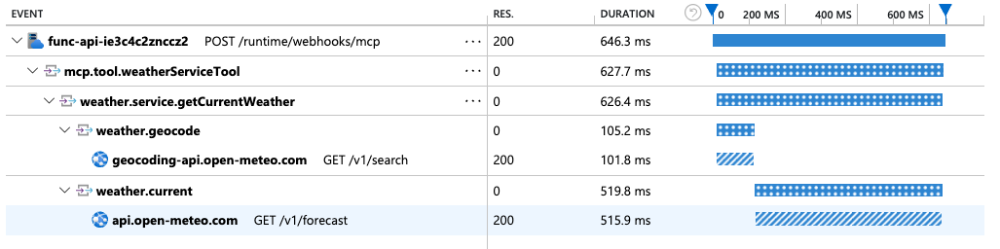

# MCP Tools — Remote MCP Server on Azure Functions (TypeScript)

This project is a TypeScript Azure Function app that exposes multiple MCP (Model Context Protocol) tools as a remote MCP server. It includes a hello world tool, snippet save/get backed by Azure Blob Storage bindings, and tools demonstrating structured content responses (images, QR codes, badges, resource links, structured data).

> **Note:** MCP prompts are in the [mcp-prompts](../mcp-prompts/) project, and the MCP App weather sample is in [mcp-weather-app](../mcp-weather-app/).

## Tools included

| Tool | File | Description |
|------|------|-------------|
| `hello` | `src/functions/helloMcpTool.ts` | Simple hello world tool |
| `helloMcpWithAuth` | `src/functions/helloMcpWithAuth.ts` | Greets the signed-in user by name via Microsoft Graph (OBO flow) |
| `savesnippet` | `src/functions/snippetsMcpTool.ts` | Saves a code snippet to blob storage |
| `getsnippets` | `src/functions/snippetsMcpTool.ts` | Retrieves a snippet from blob storage |
| `getImageWithText` | `src/functions/structured-content/imageContentSample.ts` | Returns multi-block content (text + image) |
| `getImageWithMetadata` | `src/functions/structured-content/imageContentSample.ts` | Returns `McpToolResponse` with `structuredContent` |
| `generateQrCode` | `src/functions/structured-content/imageContentSample.ts` | Generates a QR code PNG from text |
| `generateBadge` | `src/functions/structured-content/imageContentSample.ts` | Generates an SVG status badge |
| `resourceLink` | `src/functions/structured-content/resourceLinkSample.ts` | Returns a resource link content block |
| `getCodeSnippet` | `src/functions/structured-content/snippetDataSample.ts` | Retrieves a snippet with structured metadata |
| `weatherServiceTool` | `src/functions/weatherServiceTool.ts` | Gets the current weather for a city and demonstrates [OpenTelemetry-compatible distributed tracing](#opentelemetry-compatible-distributed-tracing) across the tool, service, and outbound API calls |

## Prerequisites

- [Node.js](https://nodejs.org/) 18+
- [Azure Functions Core Tools](https://learn.microsoft.com/azure/azure-functions/functions-run-local?pivots=programming-language-javascript#install-the-azure-functions-core-tools) >= `4.0.7030`
- [Azure Developer CLI (azd)](https://aka.ms/azd)
- [Docker](https://www.docker.com/). Required to run Azurite (Azure Storage emulator)

## Prepare your local environment

Start Azurite, the Azure Storage emulator required by the Functions host:

```shell
docker run -d -p 10000:10000 -p 10001:10001 -p 10002:10002 \
    mcr.microsoft.com/azure-storage/azurite
```

> If you use the Azurite VS Code extension instead, run **Azurite: Start** from the command palette.

## Run locally

From this directory (`mcp-tools/`), start the Functions host:

```shell
func start
```

The MCP endpoint will be available at `http://localhost:7071/runtime/webhooks/mcp`.

## Connect to the MCP server

### Option A: VS Code with GitHub Copilot

1. Open **`.vscode/mcp.json`** in the workspace root. Find the server called **`local-mcp-function`** and click **Start** above the name. It points to:

    ```
    http://localhost:7071/runtime/webhooks/mcp
    ```

2. In Copilot chat **agent** mode, try prompts like:

    ```
    Say Hello
    ```

    ```
    Save this snippet as snippet1
    ```

    ```
    Retrieve snippet1 and apply to newFile.ts
    ```

3. When prompted to run a tool, consent by clicking **Continue**.

### Option B: MCP Inspector

1. In a new terminal, install and run MCP Inspector:

    ```shell
    npx @modelcontextprotocol/inspector
    ```

2. Open the Inspector URL (e.g. `http://0.0.0.0:5173/#resources`).
3. Set the transport type to **HTTP**.
4. Set the URL to `http://0.0.0.0:7071/runtime/webhooks/mcp` and click **Connect**.
5. Click **List Tools**, select a tool, and **Run Tool**.

### Verify local blob storage

After testing snippet save, you can verify blobs were stored in Azurite:

```shell
az storage blob list \
    --container-name snippets \
    --connection-string "DefaultEndpointsProtocol=http;AccountName=devstoreaccount1;AccountKey=Eby8vdM02xNOcqFlqUwJPLlmEtlCDXJ1OUzFT50uSRZ6IFsuFq2UVErCz4I6tq/K1SZFPTOtr/KBHBeksoGMGw==;BlobEndpoint=http://127.0.0.1:10000/devstoreaccount1;"
```

Or open **Azure Storage Explorer** → **Emulator & Attached** → **Blob Containers** → **snippets**.

## Deploy to Azure

### Step 1: Sign in

```shell
az login
azd auth login
```

### Step 2: Create an environment

```shell
azd env new <environment-name>
```

### Step 3: Provision and deploy

This project requires OAuth-based authentication through the [built-in MCP auth feature](https://learn.microsoft.com/azure/app-service/configure-authentication-mcp?toc=/azure/azure-functions/toc.json&bc=/azure/azure-functions/breadcrumb/toc.json) with Microsoft Entra as the identity provider, and it is enabled by default.

Configure VS Code as an allowed client application for Microsoft Entra:

```shell
azd env set PRE_AUTHORIZED_CLIENT_IDS aebc6443-996d-45c2-90f0-388ff96faa56
```

Optionally enable VNet isolation:

```shell
azd env set VNET_ENABLED true
```

Deploy the project. When prompted, pick your subscription and an Azure region.

```shell
azd up
```

### Step 4: Consent to the application

The `helloMcpWithAuth` tool requires consent for delegated permission to access Microsoft Graph. For testing, you can grant consent just for yourself by logging into the application in a browser. See [Consent authoring](#consent-authoring) for how you would handle this for production scenarios.

Navigate to the `/.auth/login/aad` endpoint of your deployed function app. For example, if your function app is at `https://my-mcp-function-app.azurewebsites.net`, navigate to:

```
https://my-mcp-function-app.azurewebsites.net/.auth/login/aad
```

Sign in with your Azure subscription email and accept the permissions prompt. This completes the consent flow for you.

### Step 5: Connect to the remote MCP server

Open **`.vscode/mcp.json`** and click **Start** above **`remote-mcp-function`**. You'll be prompted for `functionapp-name` — find it in your `azd` command output or the `.azure/<env>/.env` file. You'll also be prompted to authenticate with Microsoft — click **Allow** and sign in.

> **Tip:** A successful connection shows the number of tools the server exposes. Click **More... → Show Output** above the server name to see request/response details.

> If you run into issues, see the [Troubleshooting](#troubleshooting) section below.

### Redeploy and clean up

- **Redeploy:** `azd deploy`
- **Clean up all resources:** `azd down`

## Examining the code

### Blob bindings for snippet storage

This sample uses Azure Functions [blob bindings](https://learn.microsoft.com/azure/azure-functions/functions-bindings-storage-blob?pivots=programming-language-typescript). No Azure SDK code needed:

```typescript
const blobInputBinding = input.storageBlob({
  connection: "AzureWebJobsStorage",
  path: `snippets/{mcptoolargs.snippetname}.json`,
});

app.mcpTool("getSnippet", {
  toolName: "getsnippets",
  description: "Gets code snippets from your snippet collection.",
  toolProperties: {
    snippetname: arg.string().describe("The name of the snippet.")
  },
  extraInputs: [blobInputBinding],
  handler: getSnippet,
});
```

### On-Behalf-Of (OBO) auth with `helloMcpWithAuth`

The `helloMcpWithAuth` tool (in [`src/functions/helloMcpWithAuth.ts`](src/functions/helloMcpWithAuth.ts)) demonstrates how to call a downstream API (Microsoft Graph) **as the signed-in user** using the On-Behalf-Of (OBO) flow.

**Local development** falls back to your local developer identity (Azure CLI, azd, etc.):

```typescript
if (isDevelopment) {
    credential = new ChainedTokenCredential(
        new AzureCliCredential(),
        new AzureDeveloperCliCredential()
    );
} else {
    credential = buildOnBehalfOfCredential(context);
}
```

**In production**, the `buildOnBehalfOfCredential` function exchanges the user's auth token for a Microsoft Graph token using three pieces of information:

1. **The user's bearer token** — extracted from the `X-MS-TOKEN-AAD-ACCESS-TOKEN` header (or `Authorization` fallback)
2. **The user's tenant ID** — decoded from the `X-MS-CLIENT-PRINCIPAL` header
3. **A client assertion** — obtained from a managed identity with a federated credential, proving the app's identity without a client secret

```typescript
const managedIdentity = new ManagedIdentityCredential(federatedMiClientId);

const getAssertion = async (): Promise<string> => {
    const result = await managedIdentity.getToken(
        `${tokenExchangeAudience}/.default`
    );
    return result.token;
};

return new OnBehalfOfCredential({
    tenantId,
    clientId,
    getAssertion,
    userAssertionToken: userToken,
});
```

The resulting credential is then used to call Microsoft Graph `/me` and greet the user by name:

```typescript
const tokenResponse = await credential.getToken(["https://graph.microsoft.com/.default"]);
const response = await fetch("https://graph.microsoft.com/v1.0/me", {
    headers: { Authorization: `Bearer ${tokenResponse.token}` },
});
const me = await response.json();
return `Hello, ${me.displayName} (${me.mail})!`;
```

## Consent authoring

In the steps described for this example, you consented to the application by signing into it in a browser. This allowed the application to request delegated permissions to the Microsoft Graph. There are two main ways that consent can be handled:

- **User consent** — This is the approach used in the example above. Each user signs into the application and consents to the permissions requested. They can only do this for themselves, unless they are a tenant administrator with the ability to consent on behalf of others. In this sample, user consent is appropriate because it allows you to quickly test things without impacting other users. However, the way user consent is authored in this sample does not reflect how you would typically do it in a production scenario. This is described in more detail below.

- **Admin consent** — A tenant administrator can consent to the application on behalf of all users when they sign in and review the permissions. Once this is done, individual users can sign in without needing to consent themselves. This approach is more scalable and ensures that all users can access the application without running into consent issues. For the purposes of a sample, admin consent is not appropriate, but it is a great choice for production scenarios.

The user consent approach for this sample is a separate login because the sample uses Visual Studio Code as the client. Although Visual Studio Code is pre-authorized to our application, that only creates consent for the user to call the MCP server. It doesn't create consent for the MCP server to call the Microsoft Graph on behalf of the user. When we log into the application directly, we request Microsoft Graph permissions as part of a combined consent experience.

The main difference is that because Visual Studio Code is using a single sign-on flow, it only requests a token for the MCP server. It does not present an opportunity for the user to interactively consent to any permissions needed for or by the MCP server. If you built a client that used an interactive login of some kind, you could have it all handled entirely by that client. It would not be necessary to have a separate browser login.

See [Overview of permissions and consent in the Microsoft identity platform](https://learn.microsoft.com/en-us/entra/identity-platform/permissions-consent-overview) for additional information on how Entra ID handles consent.

## OpenTelemetry-compatible distributed tracing

The `weatherServiceTool` (in [`src/functions/weatherServiceTool.ts`](src/functions/weatherServiceTool.ts)) demonstrates end-to-end [distributed tracing](https://learn.microsoft.com/azure/azure-functions/opentelemetry-howto?pivots=programming-language-typescript) with [OpenTelemetry](https://opentelemetry.io/). Each invocation produces a span for the MCP tool, a child span for the weather service, and child spans for the geocoding and forecast calls — all correlated under the Azure Functions host request.

Tracing is configured in two places:

1. **`host.json`** turns on OpenTelemetry output from the Functions host:

    ```json
    {
      "version": "2.0",
      "telemetryMode": "OpenTelemetry"
    }
    ```

2. **`src/telemetry.ts`** initializes the worker's tracer provider and exports spans to Application Insights. It uses a `SimpleSpanProcessor`, authenticates the exporter with the app's managed identity, and registers the Azure Functions and `undici` (global `fetch`) instrumentations so outbound HTTP calls appear as child dependency spans:

    ```typescript
    const clientId = getManagedIdentityClientId();
    const exporter = new AzureMonitorTraceExporter({
        connectionString: aiConnectionString,
        ...(clientId ? { credential: new ManagedIdentityCredential(clientId) } : {}),
    });

    const provider = new NodeTracerProvider({
        spanProcessors: [new SimpleSpanProcessor(exporter)],
    });
    provider.register();

    registerInstrumentations({
        tracerProvider: provider,
        instrumentations: [
            new AzureFunctionsInstrumentation(),
            new UndiciInstrumentation(),
        ],
    });
    ```

`initializeTelemetry()` is called once at module load in [`src/index.ts`](src/index.ts), before any functions are registered. The tool code then creates spans with the OpenTelemetry API (`trace.getTracer(...).startActiveSpan(...)`) and adds attributes such as the requested city and resolved coordinates.

### Viewing the traces

After invoking `weatherServiceTool` against your deployed server app:

1. In the [Azure portal](https://portal.azure.com), open the **Application Insights** resource created with the app (its name is in your `azd` output or the `.azure/<env>/.env` file).
2. In the left menu, select **Investigate → Search**.
3. Set the time range to the **last 30 minutes** and refresh.
4. Select a `weatherServiceTool` trace to open the **end-to-end transaction details**. You'll see a span hierarchy like the one below, with the tool, the weather service, and the outbound `open-meteo` HTTP dependencies nested under the host request:

    

## Troubleshooting

| Problem | Solution |
|---------|----------|
| Connection refused locally | Ensure Azurite is running (`docker run -p 10000:10000 -p 10001:10001 -p 10002:10002 mcr.microsoft.com/azure-storage/azurite`) |
| Snippet save/get returns errors | Verify Azurite is reachable and `local.settings.json` has `"AzureWebJobsStorage": "UseDevelopmentStorage=true"` |
| `helloMcpWithAuth` fails locally | Ensure you're signed in with `az login` or the VS Code Azure account extension |
| OBO errors in deployed server | Verify that consent has been granted (see Step 4) and that the Entra app registration is configured correctly |
| `An error occurred invoking 'helloMcpWithAuth'` right after `azd up` | Restart the function app: `az functionapp restart -g <resource-group> -n <function-app-name>`. The OBO flow signs a client assertion with the user-assigned managed identity via a federated identity credential (FIC). Right after provisioning, the auth runtime can hold a stale signing credential while the FIC propagates in Entra. Check **Application Insights > Logs** for `AADSTS50013: Assertion failed signature validation` to confirm. |
| Generic "An error occurred invoking" with no details | Check **Application Insights > Logs** and query `exceptions \| where timestamp > ago(1h) \| project timestamp, outerMessage, innermostMessage` to find the actual error. |
| 403 error or "Cannot force new registration for a non-dynamic authentication provider" | Ensure `host.json` has `extensions.mcp.system.webhookAuthorizationLevel` set to `"Anonymous"`. Without this, EasyAuth validates the token but the Functions host still requires a system key — resulting in 403. Also verify that VS Code's client ID (`aebc6443-996d-45c2-90f0-388ff96faa56`) is in the `allowedApplications` list in EasyAuth config. |

## Next Steps

+ Learn more about the [Azure Functions MCP extension](https://learn.microsoft.com/azure/azure-functions/functions-bindings-mcp?pivots=programming-language-typescript)
+ Learn more about [built-in MCP auth](https://learn.microsoft.com/azure/azure-functions/functions-mcp-tutorial?tabs=mcp-extension&pivots=programming-language-python#remote-mcp-server-authorization)
+ Connect your MCP server to [Foundry agents](https://learn.microsoft.com/azure/azure-functions/functions-mcp-foundry-tools?tabs=oauth-id%2Cmcp-extension%2Cfoundry)
